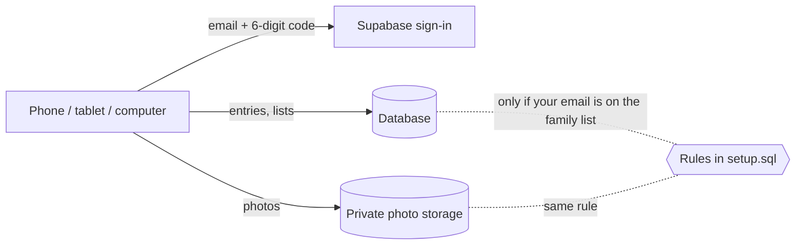

# Island Dreams

Our family journal from camp in the Thousand Islands. It replaces the paper
journal we started in July 2023.

**Open it:** `https://lemassif.github.io/bug-free-octo-succotash/island/`
(or tap **Island Dreams** on the arcade menu). It works in any phone, tablet
or computer browser, and nobody needs Claude or an app store. On an iPhone or
iPad, open it in Safari, tap Share, then **Add to Home Screen**.

## What each entry holds

- **Date and time.** These start as right now. Change them to copy in older
  pages from the paper journal.
- **Who was there?** A drop-down where you can tick more than one: PAPA, MEMA,
  Susan, Joshua, Jackie, Rebekah, Satomi, Sora, Katie, Lorenzo, Haru, Chance,
  Tatiana. The last line of the list adds someone new.
- **What did we do?** Also a multi-select drop-down: Fish caught, Campfire,
  Boating, Boat sightings, Tubing, Swimming, Cooking on the boat, Geocaching,
  Sightseeing, Fireworks. You can add new activities here too.
- **Headline** (optional) and the **journal entry** itself.
- **Photos.** **Take a photo** opens the camera. **Choose photos** opens the
  photo library and lets you pick several at once.

Anything added to either list is saved for the whole family. You can take a
choice off a list in Settings (⚙︎); older entries that use it keep it.

The journal lists entries newest first, grouped by year. You can search it
and filter it by year. Tap a photo to view it full screen and swipe between
photos. **Share** emails an entry. On a phone, **Share with photos** sends the
pictures as well.

Photos are shrunk before upload, to about 300 KB each with a small thumbnail
for the list. That keeps uploads quick on the river's slow signal. Location
data is removed from photos, so no GPS position is uploaded.

## How the family shares one journal

Until it is set up, the app keeps entries **only in the browser that wrote
them**. A banner at the top says so. Sharing needs a free online database.
The app uses [Supabase](https://supabase.com) for this:

- **Sign-in.** Each person types their email address and gets a 6-digit code.
  There are no passwords to remember. A device stays signed in afterwards.
- **The family list.** Only email addresses on this list can see or add
  anything. Anyone on the list can add another family member under
  ⚙︎ → Family. Once someone is added, the app offers to email them an
  invitation.
- **Privacy.** Entries and photos are private. The database rules
  (`island/setup.sql`) refuse every request from an address that is not on
  the list, and photos are only served through links that expire.



### One-time setup

This takes one person about 20 minutes on a computer.

1. **Create the project.** Sign up at supabase.com, choose **New project**,
   and pick the free plan. Any name and region work; *US East* is closest to
   the river.
2. **Create the tables.** Open the project's **SQL Editor** and paste in all
   of [`island/setup.sql`](island/setup.sql). On the last lines, change
   `you@example.com` to **your** email address, then press **Run**. The script
   is safe to run again.
3. **Connect the app.** Go to **Project Settings → API**. Copy the
   **Project URL** and the **anon public** key into
   [`island/config.js`](island/config.js), then commit the change. The anon key
   is meant to be public. Never use the `service_role` key here.
4. **Tell Supabase where the app lives.** Under
   **Authentication → URL Configuration**, set **Site URL** to
   `https://lemassif.github.io/bug-free-octo-succotash/island/`.
5. **Put the code in the sign-in email.** Under
   **Authentication → Emails → Templates → Magic Link**, add this line to the
   message:
   `Your Island Dreams code is {{ .Token }}`
   The code matters because a link in an email opens in Safari, not in the
   Home Screen app, so a typed code is the reliable way to sign in.
6. **Set up email sending (required).** Supabase's built-in email only sends
   to members of your Supabase team and only a few messages an hour, so other
   family members would never get their codes. Under
   **Authentication → Emails → SMTP Settings**, turn on custom SMTP. Gmail
   works for a family: host `smtp.gmail.com`, port `465`, username = your
   Gmail address, password = a Gmail
   [app password](https://myaccount.google.com/apppasswords). The free tier of
   a service like Resend works too.
7. Open the app, sign in with your email, and add everyone else under
   ⚙︎ → Family.

### Free-plan limits

- **Photo storage: 1 GB.** That is roughly 3,000 photos at the app's size.
- **Pausing.** Supabase pauses a free project after a week with no activity.
  The data is kept; you restore the project from the Supabase dashboard. If
  that becomes a nuisance over the winter, the paid plan does not pause.

## Files

| File | What it does |
|------|--------------|
| `island/index.html`, `island/app.css` | the page and its look |
| `island/js/app.js` | screens: journal, entry, write/edit, settings, sign-in |
| `island/js/store.js` | saving and loading, online (Supabase) or this-device-only (IndexedDB) |
| `island/js/photos.js` | shrinks photos and strips their location data |
| `island/config.js` | the Supabase address and public key |
| `island/setup.sql` | creates the tables, privacy rules, photo bucket and starting lists |
| `island/sw.js` | saves the app for opening offline |
| `island/vendor/supabase.js` | Supabase's client library, v2.117.3 |
| `island/test/smoke.js` | browser test of the this-device mode |

Run the test from the repo root:

```
npx http-server -p 8099 -s -c-1 .
node island/test/smoke.js
```

## Not built yet

- **Writing with no signal.** The app opens offline, but saving needs a
  connection. If a save fails, the form stays open to try again. The words of
  an unsaved new entry are kept on the device even if the app is closed;
  unsaved photos are not.
- **Fish details** (count, species, size) and other per-activity details.
- **Notifications** when someone adds an entry.
